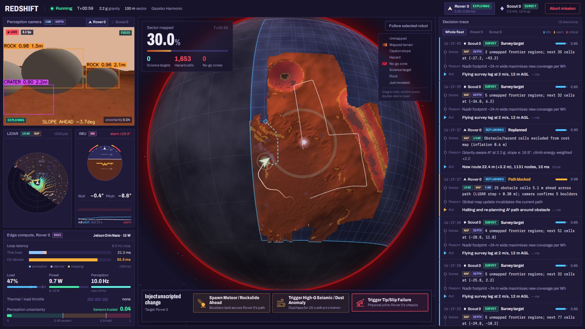

# Redshift: Autonomous Super-Earth Planetary Mapping Fleet

Embodied multi-agent robotics for the **Agentverse 2026 Robotics Track** ("Give an agent a body").

A fleet of two rovers and an aerial drone maps an unexplored sector of a 2.2 g Super-Earth in **Gazebo Harmonic**: *Scout Rover 1* (`rover_0`), *Heavy Recovery Rover 2* (`rover_1`) and a *Survey Drone* (`scout_0`). Everything they do runs locally on **ROS 2 Jazzy**, with no cloud calls:

- **Perception:** RGB-D + LiDAR + IMU, with uncertainty estimated from the sensor data itself.
- **Mapping:** one shared, gravity-aware fog-of-war map.
- **Planning:** A* that knows what slope the rover can climb at the selected gravity.
- **Self-diagnosis:** each rover estimates its own health from IMU shocks, motor-controller diagnostics and a commanded-vs-measured wheel-speed check, and integrates its battery from solar input and its drive and compute load.
- **Recovery:**
  - *Tip/slip:* a safe-hold routine retreats, marks the hazard and sends the drone to inspect it.
  - *Critical damage:* a crippled rover holds safe and broadcasts an SOS. The recovery rover drives over and docks once its own camera, depth and LiDAR confirm the damaged unit. It runs a field repair, and both rovers go back to mapping.

Each robot's onboard computer is simulated against a real edge-compute power budget. A FastAPI + rclpy bridge streams the fleet into a React + Three.js **Mission Control**. Its 3D globe reveals the sector as it is mapped. It also shows live sensor feeds and a Sense → Reason → Act trace for every decision. Inject buttons let you change the world in the middle of a run.



## Quick start

```bash
./start_all.sh            # builds what is stale, then serves Mission Control
# open http://localhost:8000 → configure → DEPLOY FLEET
./stop_all.sh             # or Ctrl+C in the start_all terminal
```

`start_all.sh`:
- sources ROS 2;
- puts the nvm Node ahead of any Windows `npm` that WSL exposes;
- rebuilds the colcon workspace and the web UI only when their sources changed;
- keeps Gazebo and DDS traffic on localhost;
- runs the backend on `:8000`.

Missions are launched from the UI. Ctrl+C aborts the running mission and reaps every simulator process.

| Flag | Effect |
|---|---|
| `--dev` | also run the Vite dev server with hot reload on `:5173` (proxied to the backend) |
| `--rebuild` | force the colcon and web builds |
| `--ui-demo` | no ROS needed: serve the UI against the scripted fake backend in `web_ui/dev/` |
| `--port N`, `--host H` | bind elsewhere (`--host 0.0.0.0` to reach it from another machine) |

### Simulation speed

Pick **0.5× / 1× / 1.5× / 2×** on the pre-launch screen, or switch it live from the Mission Control top bar, which
also shows the achieved real-time factor (`RTF`, amber when the simulator can't keep up). Every autonomy node runs on
simulated time (`use_sim_time`, `/clock`). So holds, timeouts, dedup windows and sensor rates are counted in simulated
seconds, and a mission plays out the same way at any speed, only faster or slower. 2× is handy for recording; 0.5× for
watching a recovery closely.

- **Gazebo** paces physics with its `real_time_factor`; a live change goes through `/world/redshift/set_physics`.
- **The mock world** is a lockstep clock: time waits for any sensor frame still rendering, so sensor rates hold per
  simulated second and an overloaded renderer slows the clock instead of dropping frames. Its ray casting runs in
  worker processes.

Measured on the development laptop (8 cores, RTX 5050), with the full autonomy stack:

| Fleet | Gazebo | Mock |
|---|---|---|
| 2 rovers + drone (default) | 1× holds (0.99–1.03); 2× requested → 1.24× | 1× holds (1.0); 2× requested → 1.29× (the world alone holds 2×) |
| 1 rover + drone | 2× holds (1.8–2.05) | 1× holds |

Above what the machine can render, the mission still runs correctly, only slower than requested.

## The 60-second demo

The brief asks for one continuous take of at most a minute, with perception on screen next to the actions and at least one unscripted change. At 1× the full rescue does not fit in the same minute as the other beats, so there are two takes.

**Take A: adaptation, from deploy to wrap-up**

| Time | Action | What you see |
|---|---|---|
| 0:00 | Medium sector · **2.2 g** · 2 rovers + 1 drone · Orin Nano 15 W → **Deploy fleet** | Gravity preview: max climbable slope 16.9° (limited by wheel torque), tip alarm 28.9°, 0.83 m/s |
| 0:10 | (autonomous) | Boot checklist goes green in ~5 s; fog lifts on the globe as the three robots explore; traces stream |
| 0:20 | **Spawn Meteor / Rockslide Ahead** | Meteor streak, then boulder boxes in the camera; `Path blocked` trace about 1 s later; the route re-plans around the slide |
| 0:32 | **Trigger High-G Seismic / Dust Anomaly** | Camera hazes; uncertainty passes 0.45 → **CAUTION**: LiDAR-only at 35 % speed; fused navigation returns when the dust clears |
| 0:42 | **Trigger Tip/Slip Failure** | A real roll jolt (the IMU measures it) → **SAFE HOLD** → reverse along breadcrumbs → permanent no-go zone on the map → drone flies over to scan it → **RESUMING** |
| 0:58 | (wrap-up) | % mapped, science targets, and the edge budget (latency, load, watts, throttle) |

**Take B: the critical failure mode, fleet self-rescue.** Start recording with the fleet already exploring. Trigger the strike while Rover 2 is near Rover 1: most of the rescue is the drive over, about 57 s at 1× from 22 m away, and 150 s from 45 m.

| Time (22 m gap, Gazebo 1×) | Action | What you see |
|---|---|---|
| 0:00 | Select ROVER_2's camera; **Trigger Critical Damage on Rover 1** | Debris strike: Rover 1's IMU shock and motor faults in the live sensor panel; health below 15 % → SAFE-HOLD → **SOS** banner |
| 0:01 | (autonomous) | Rover 2 drops its frontier: AUTONOMOUS RESCUE MODE and a route to a stand-off beside Rover 1 |
| 0:40 | (autonomous) | Stand-off reached. Rover 2's camera boxes the damaged unit, **[PERCEIVED: DAMAGED UNIT ROVER_1 \| DOCKING FOR REPAIR]**, confirmed by depth and LiDAR; it creeps in to 1.45 m |
| 0:48 | (autonomous) | Docked → REPAIRING: Rover 2's repair tool works on Rover 1's drivetrain (4 s, only within 1.6 m) |
| 0:52 | (autonomous) | Rover 1's own motor diagnostics read nominal → health back to ~90 % |
| 0:57 | (autonomous) | Rover 2 backs off 2 m; both rovers resume mapping |

## How it maps to the judging criteria

Weights are the official Agentverse 2026 Robotics Track ones.

**Perception-driven action (25 %): every decision traces to what was perceived**
- *Local OpenCV perception (`vision.py`).*
  - Boulders: depth-geometry bumps confirmed by colour.
  - Craters: depth pits.
  - Science crystals: cyan in HSV.
  - Steep patches: local plane fits.
  - Rover only: a LiDAR corridor check that rejects sparse dust backscatter.
- *Teammates are perceived, not assumed.* The fleet link says where the damaged rover should be. The rescuer only switches to perception-guided docking once its own camera box is confirmed by depth (or by LiDAR returns) at the expected range: `[PERCEIVED: DAMAGED UNIT ROVER_1 | DOCKING FOR REPAIR]`.
- *Uncertainty* is computed from the data, never read from a dust flag:
  - camera: sharpness, contrast and noise vs. a clear-sky baseline, which follows a change of scenery only while the LiDAR independently confirms clear air;
  - LiDAR: return ratio, near-field spurious returns, range noise;
  - IMU: vibration.
- *Health from the rover's own sensors* (`rover_health.py`), never from the world's damage state:
  - IMU shocks (armed only once the accelerometer reads steady gravity, so sensor start-up is not an impact);
  - motor-controller diagnostics, cross-checked against commanded vs. measured wheel speed.
- *Decision traces.* Every decision is a trace (`trace.py`) with the sensors used (`CAM`, `DEPTH`, `LIDAR`, `IMU`, `ODOM`, `MAP`, `FLEET`, `DIAG`), the input, the reasoning, a confidence and the action. Mission Control shows them as Sense → Reason → Act rows next to the live camera, depth, LiDAR and IMU readings.

**Adaptation to change (25 %): scene changes mid-run, the fleet visibly re-plans**
- *Rockslide.* Boulders drop across the rover's *current* planned path, 7 m ahead. With less route left they land closer, so never past its end; within 4 m of its goal they wait for its next route. LiDAR obstacle evidence blocks the path → visible `REPLANNING` → a new A* route (+Δ m, nodes, ms).
- *Dust / seismic anomaly.* A sensor-effects layer hazes, blurs and adds noise to RGB; drops returns and adds backscatter to LiDAR; vibrates the IMU. The rover's FSM switches to LiDAR-only, with slower speed and extra inflation, and returns to fused navigation when its sensors say the air has cleared.
- *Debris strike.* A real force on the chassis (the IMU measures it) plus drivetrain faults drops health below 15 %. The damaged rover goes SAFE-HOLD → SOS. The recovery rover drops its frontier, re-plans to a stand-off beside it, and docks on perception.

**Operational autonomy within an edge budget (15 %)**
- *Edge budget.* `edge_budget.py` scales the measured host latency by an edge profile: Jetson Orin Nano/NX/AGX or Raspberry Pi 5.
  - It reports the device latency, load and power, and that power feeds the battery model.
  - It throttles the perception rate by 25 % above 90 % load and restores it below 60 %, with dwell times and prediction so it doesn't oscillate.
- *Gravity-aware physics.* `physics_model.py` derives the climbable slope from wheel torque, soil traction (Mohr–Coulomb) and the static tip angle at the selected g.
  - The same torque limit is written into the Gazebo wheel joints, so the simulated rover stalls exactly where the planner says it cannot climb.
  - At 1 g the limit is about 37° (traction-bound). At 2.2 g it is 16.9° (torque-bound).
- *Sensible when unsure (`agent_fsm.py`).* High uncertainty → CAUTION; tip (roll or pitch past the alarm angle), slip (wheel odometry vs. measured motion) or critical health → SAFE-HOLD. Nothing calls home.

**Relevance & impact (20 %): the most critical failure mode, handled on screen**
- On a 2.2 g world with no one to send, a crippled rover means the mission is over. Here the fleet rescues itself:
  1. **SOS** (1 Hz heartbeat with position, health and fault codes);
  2. **rescue transit** (A* to a stand-off cell, with the teammate as an obstacle);
  3. **perception-guided docking** (creeps in on the fused range and stops at 1.45 m);
  4. **field repair**, verified by the damaged rover's own motor diagnostics;
  5. both rovers **resume** mapping.
- Mission Control shows the whole sequence: the SOS banner, the transit / docking / repairing / done track, the lock-on box in the rescuer's camera, and the damaged rover's health, faults and battery live.
- The tip/slip failure ends with the same honesty: reverse along breadcrumbs, mark a permanent no-go zone, send the drone to verify, then resume.

**Ambition & technical quality (15 %)**
- Two simulator backends behind one topic contract (Gazebo Harmonic, and a numpy mock world rendered in worker processes), checked against each other by `check_topics.py`.
- Everything runs on simulated time at a selectable speed.
- 219 Python and 57 TypeScript unit tests. The end-to-end smoke test drives every injected change plus the full rescue on both backends.

**Pre-launch configuration and fog-of-war globe**
- *Configuration:* sector size, gravity 1–3 g (feeds both the Gazebo `<gravity>` and the planner), fleet of 1–2 rovers + 0–1 drone (default 2 + 1), edge profile, simulator backend, seed, simulation speed.
- *Globe:* the sector is a patch on a fogged planet. A shader decodes the live `/planet_map` layers: elevation, hazard / caution / no-go, science, and newly revealed cells. Robot markers, planned paths, trails, scan cones, SOS distress rings and the rescue tether are drawn on top.

## Architecture

```
 Web UI (React 19 / R3F) ──REST /api/*──► FastAPI backend ──spawns──► ros2 launch redshift_sim mission.launch.py
        ▲   one WebSocket /ws               │ rclpy RosLink (background thread)            │
        └──── telemetry · camera · lidar · map · trace · event ◄──────────────────────────┤
                                                                                           ▼
   ┌─ gazebo: gz sim (headless rendering) + ros_gz parameter_bridge + world_interface_node (commands, rover hardware)
   └─ mock:   mock_world_node (kinematics + numpy ray-cast LiDAR / depth / RGB in worker processes, same topics)
          │ raw: /<r>/{camera/image_raw, camera/depth_raw, lidar/points_raw, imu_raw, odom, wheel_odom, hw_status}
          ▼
   sensor_effects_node (dust / seismic) → /<r>/{camera/image, camera/depth, lidar/points, imu}
          ▼                                      ▼
   perception_node (per robot)        mapping_coordinator_node → /planet_map (+ elevation, layers, stats)
          │ detections (incl. perceived teammates) · uncertainty  ▲ /fleet/hazard_marks
          │ annotated JPEG · depth colormap JPEG                  │
          ▼                                                       │
   agent_planner_node (rover | scout) → cmd_vel · planned_path · agent_state (health, rescue) · edge_telemetry ·
        rover_health + agent_fsm        /agent_decision_trace · /fleet/{claims, scan_request, scan_complete, sos, rescue}
```

**Design rules**
- *No ground truth reaches the autonomy stack.* It sees only degraded sensor topics and odometry.
- *The pure algorithms are unit-tested, and the ROS nodes are thin wrappers around them.* The algorithms live in `physics_model`, `edge_budget`, `grid_map`, `planning`, `agent_fsm`, `rover_health`, `vision`, `trace`, `terrain_gen`, `scene_events`, `rover_hw`, `mock_render`, `render_pool` and `mock_dynamics`.
- *The world is regenerated per deploy from a seed:* heightmap, regolith texture, boulders, craters, ridges and science crystals. Robots are embedded at their spawn poses.
- *Messages:* JSON over `std_msgs/String` for traces, detections, agent state and fleet coordination; typed messages for sensors, maps, paths and `cmd_vel`. The full contract is in [`docs/protocol.md`](docs/protocol.md).

### Two world backends, one topic contract

**Gazebo Harmonic** is the primary backend: DART physics with Bullet collision, `gpu_lidar`, RGB-D and IMU sensors, DiffDrive and VelocityControl. Rockslide, jolt and debris-strike commands run through gz-transport. The simulated rover hardware (`rover_hw.py`: per-wheel drivetrain health and fault codes, motor current, solar output) scales each rover's wheel commands, so a damaged rover crawls and veers.

**The mock world** is the fallback. The backend switches to it automatically if Gazebo has not delivered a camera frame from every robot within 45 s, or if a Gazebo process exits during start-up. You can also pick it in the UI. It:
- renders the same terrain, boulders, crystals and robot bodies with vectorized numpy ray casting (camera ≈ 30 ms, LiDAR ≈ 12 ms per frame). Rendering runs in a pool of worker processes (`render_pool.py`), because one process could not hold 1× for the two-rover fleet. Output is bit-identical to rendering in-process;
- reuses the same physics model for torque stalls;
- runs the jolt as a closed-loop roll mode.

`ros2_ws/src/redshift_sim/scripts/check_topics.py` checks the mock against a reference capture from Gazebo (`gz_signature.json`). It compares names, types, rates, frame ids, encodings, camera intrinsics, point-cloud layout, ring order and the no-return encoding. The mock currently passes (`PARITY OK`).

## Requirements

Tested on Ubuntu 24.04 under WSL2 with WSLg:
- ROS 2 Jazzy, with `ros_gz_bridge`, `ros_gz_sim` and `cv_bridge`;
- Gazebo Harmonic (gz-sim 8.15), whose `gz.transport13` / `gz.msgs10` Python bindings ship with it;
- Python 3.12 with numpy, OpenCV 4.6, SciPy, FastAPI, uvicorn, pydantic 2 and PyYAML. The smoke test also needs `httpx` and `websockets`;
- Node.js ≥ 20 (developed on v25 via nvm). Web dependencies are exact-pinned in `web_ui/package.json`, and fonts are bundled, so there are no CDN calls.

Without Gazebo, `start_all.sh` warns and only the mock backend works. Without ROS, use `./start_all.sh --ui-demo`.

## Testing

```bash
python3 -m pytest -q                                   # 219 unit tests: autonomy, sim, backend
(cd web_ui && npm run typecheck && npm test)           # TypeScript + 57 vitest tests
python3 backend_bridge/scripts/smoke_test.py --backend mock     # end-to-end against a running backend
python3 backend_bridge/scripts/smoke_test.py --backend gazebo
python3 backend_bridge/scripts/smoke_test.py --backend gazebo --rovers 1 --speed 2   # 1 rover, 2× simulation speed
```

The smoke test drives the same REST and WebSocket traffic as the UI (default fleet: 2 rovers + drone; `--rovers 1` for one):
1. deploy, then confirm telemetry, camera, LiDAR and map streams and exploration progress;
2. rockslide → `path_blocked` + `replanned`;
3. dust → CAUTION / LiDAR-only, then recovery;
4. tip → `safe_hold`, `recovery_reverse`, `hazard_marked`, `scout_tasked`, `scan_complete`, `resume`, and a permanent hazard on the map;
5. nothing so far was read as critical damage;
6. with two rovers, a debris strike on Rover 1:
   - the world event and the perceived health (< 15 %, fault codes);
   - `critical_damage` → `sos` → Rover 2 `rescue_start` → `rescue_dock` → `docked`, with the perception lock-on label;
   - Rover 1 `repaired` → `repair_complete` → both `resume`;
   - the world accepted the repair within 1.6 m, and both rovers are mapping again;
7. the achieved real-time factor matches `--speed`, mission time follows simulated time, and a live speed change takes effect;
8. unique trace ids;
9. abort, with no simulator process left.

Timeouts are in simulated seconds: below 1× they are stretched to wall time.

Latest runs (2 rovers + drone, 1×):
- **Gazebo 43/43.** Rockslide → `path_blocked` in 0.9 s. Dust → CAUTION in 2.8 s and back after 20 s. Tip → `safe_hold` in 0.5 s and `resume` after 35 s. Strike → `sos` in 1.8 s; the rescuer reached its stand-off after 52 s, docked at 1.44 m after 63 s, and both rovers were mapping again after 74 s.
- **Mock 42/42** (Gazebo has one extra check: no fallback to mock). Also 27/27 with one rover.

Known intermittent issue: in 1 of the last 3 full Gazebo runs the rescue did not happen. The damaged rover had stopped 2 m from the centre of a second 2.5 m permanent hazard zone next to its own, so no cell 2.0–2.45 m from it was free; the rescuer reported `rescue_noroute`, aborted after 6 s, and retried 20 s later with the same result. Where that second zone came from is still being investigated (`--dump` now records the map when this happens). The same run paced at 0.45× instead of 1× under CPU load.

At 2× with 2 rovers + drone, every behaviour check passes, but the pacing check fails on both backends: Gazebo reaches 1.24× and the mock 1.29× (see *Simulation speed*).

When a check fails, the smoke test prints the rover's state, the world event and what the robots traced. `--dump run.jsonl` also writes every trace and event, a 1 Hz pose / state sample per robot, and planet-map snapshots, so a failed repeat can be diagnosed afterwards. Repeat harnesses found and fixed these intermittent failures (Gazebo-only unless marked):
- **A false critical-damage report at start-up.** The Gazebo IMU starts at 0 and then spikes to 40 g. Shock detection now arms only once the IMU reads steady gravity.
- **A false critical-damage report after the tip jolt.** The chassis is briefly airborne, then one 65 g contact spike as it lands. Only acceleration above gravity, held for at least 2 samples, now counts as an impact.
- **A tip jolt the 10 Hz FSM missed.** The FSM now sees the peak attitude and rate of each 100 ms IMU window; 6/6 repeats at 2× now trigger.
- **A rescuer stuck re-planning.** A route that leaves through the rover's own inflation ring was flagged as blocked by that ring on every map update. Only cells that became lethal after the route was planned now block it.
- **A stand-off the planner always rejected.** The fixed 2.2 m stand-off fell inside the damaged rover's own peer disc and inflation ring (≈ 2.0–2.5 m). The teammate is now planned as an uninflated keep-out, and the rescuer searches the whole 2.0–2.45 m ring for a free cell it can reach, approach side first.
- **A rover sealed inside its own hazard zone.** When the reverse timed out short of the 2.5 m zone, the zone covered the rover and every way out. The zone now shrinks to stay 0.6 m clear of the rover (never below 1 m).
- **False slip safe-holds under CPU load.** Ground speed was differentiated over message arrival times, so bunched odometry deliveries read as a stall. It now uses the odometry's simulated timestamps.
- **Mock only: a gentle stall read as a 263 g impact.** The pacer splits physics steps at sensor due times, so a step can last microseconds; backing into a rock zeroed the ground speed in one step, and the accelerometer read that velocity step divided by the step length. The health model wrote the rover off after an ordinary recovery reverse. The mock accelerometer now follows the stall through ≈ 50 ms of tyre compliance.
- **A lost rescue re-plan.** `rescue_start` arrived 0.1 s after RESUMING's re-plan, and the 1 s re-plan rate limit dropped it, so the rescuer first drove its old frontier route away from its teammate. A request inside the gap is now held and served when the gap ends.

## Repository layout

```
start_all.sh · stop_all.sh            one-command bring-up / teardown
docs/protocol.md                      topic, JSON, REST and WebSocket contracts
ros2_ws/src/redshift_sim/             world generation, Gazebo models + launch, world interface, rover hardware
                                      (rover_hw), sensor effects, mock world (mock_render, render_pool,
                                      mock_dynamics, mock_world_node), check_topics.py
ros2_ws/src/redshift_autonomy/        physics_model, edge_budget, grid_map, planning, agent_fsm, rover_health,
                                      vision, trace + perception_node, mapping_coordinator_node, agent_planner_node
backend_bridge/                       FastAPI app, rclpy link, mission manager (launch, watchdog, fallback, abort),
                                      encoders, config schema, tests, scripts/smoke_test.py
web_ui/                               React + Three.js Mission Control; dev/ holds the scripted fake backend
```

## Troubleshooting

- **The page doesn't load from the Windows browser.** WSL2 forwards `localhost` by default. If yours doesn't, run `./start_all.sh --host 0.0.0.0` and use the WSL IP address.
- **"port 8000 is already in use".** A previous run is still up. Run `./stop_all.sh`, or pass `--port`.
- **The RTF readout is amber / below the chosen speed.** The simulator can't render that fast on this machine (see *Simulation speed*). The mission still runs correctly, only slower than requested.
- **Gazebo is slow or never produces frames.** The backend falls back to the mock world after 45 s without camera frames (or at once if Gazebo exits during start-up), and says so in the boot log and as an event. Choose *Mock physics* in the UI to skip Gazebo entirely.
- **`npm` resolves to `/mnt/c/...`.** That is the Windows npm. `start_all.sh` prefers the newest nvm Node; install one with `nvm install 22`.
- **Simulator processes are left over after a crash.** Run `./stop_all.sh`. Its patterns only match this checkout's `runtime/` world and `install/` nodes, the `redshift_sim` launch and the bridge's `redshift_gz_bridge` node, so other Gazebo or ROS work on the machine is left alone.

## License

See [LICENSE](LICENSE).
